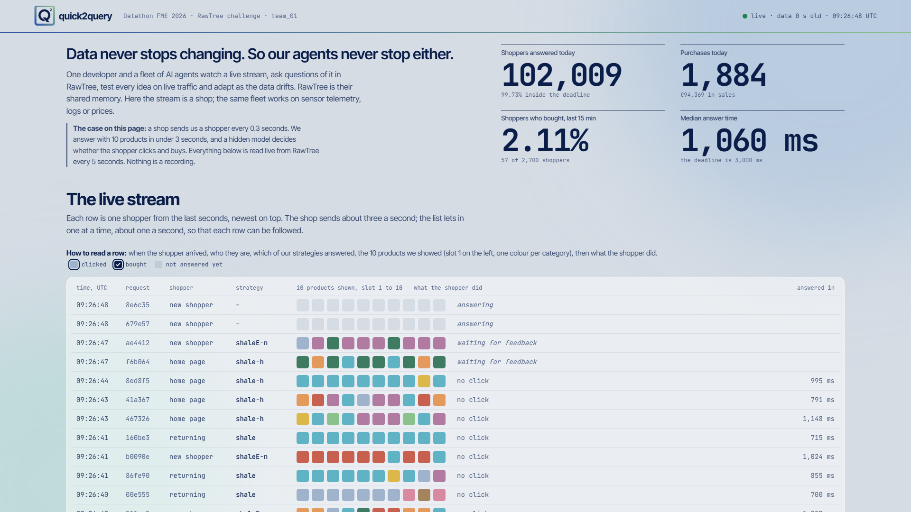
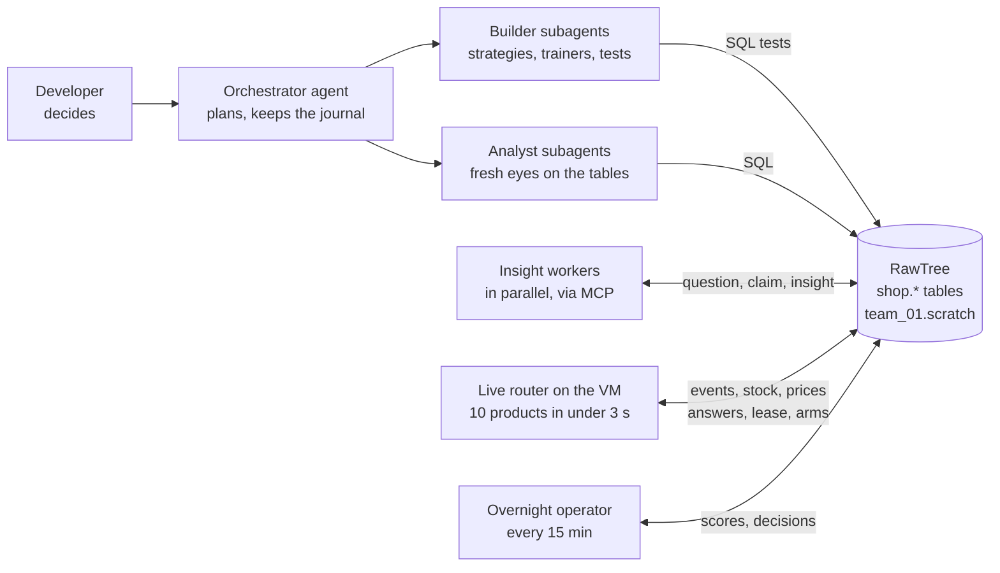
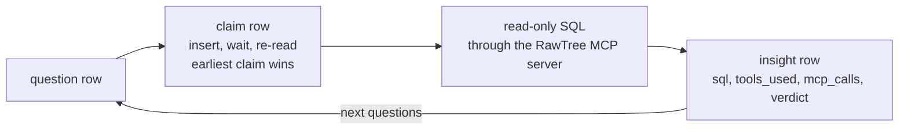
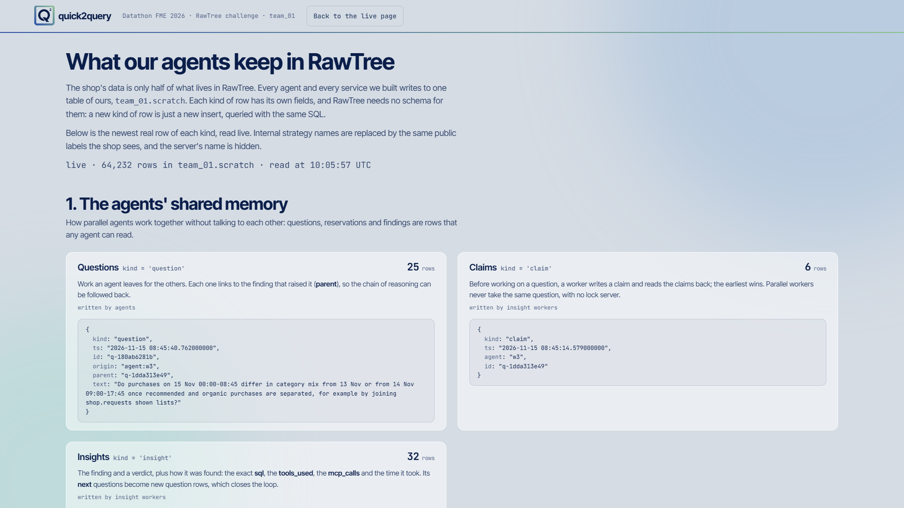

# quick2query

**One developer and a fleet of AI agents, with RawTree as their shared memory.**
Data never stops changing, so the agents never stop either.

[](https://quick2query.com)
[](https://quick2query.com/rawtree)
[](docs/explainer.html)

Datathon FME 2026 · RawTree challenge · team_01 · side challenge: *Best agentic use of RawTree*

> **Live demo:** [quick2query.com](https://quick2query.com) shows real-time predictions, feedback, the agent fleet and the numbers.
> **[quick2query.com/rawtree](https://quick2query.com/rawtree)** shows the newest real row of each kind our agents keep in RawTree, read live.

| | |
|---|---|
| **For** | One developer running a live system whose data keeps changing: a shop here, sensors, logs or prices elsewhere. |
| **Problem** | What worked yesterday stops working, and there is never time to design a schema for each new kind of data. |
| **The agents decide** | What to store, which questions to ask next, which strategies to build and test, and what their own traces say about how they work. |
| **Why RawTree** | Any JSON goes in as it is, a new kind of data is just inserted, and agents query everything through the MCP server, the CLI or the API with plain SQL. |

A simulated shop sends us a shopper about every 0.3 seconds. We answer with 10 products in under 3 seconds, and a hidden model decides whether the shopper clicks and buys.

That is the main challenge. This README is about how we worked on it:

- **Agents drive.** An orchestrator agent, builder and analyst subagents, parallel insight workers, a live router and an overnight operator rule. The developer decides; the agents build, measure, watch and act.
- **RawTree is the memory.** Besides the shop's tables, every agent and service writes to one table of ours, `team_01.scratch`, with no schema: questions, claims, insights, traffic splits, operator decisions, a single-writer lock, leaderboard copies. More than 63,000 rows.
- **The agents audit themselves.** Every tool call lands in RawTree as a trace row. Insight workers query those traces, and their first audit found a gap in our own telemetry, which we then fixed.
- **Dev and prod.** Agents work on a laptop. Production is a VM that keeps getting deployed: a new model every 20 minutes, traffic changes hot-reloaded.
- **Live traffic decides.** Models share live shoppers by hash. A challenger is promoted only after it leads the champion twice in a row. Overnight, an operator loop did this alone and logged every decision to RawTree. It is a statistical rule, not an LLM: the agents propose, the rule promotes.



## Contents

- [The agent fleet](#the-agent-fleet)
- [RawTree beyond the main challenge](#rawtree-beyond-the-main-challenge)
- [Dev and prod](#dev-and-prod)
- [Champion and challengers on live traffic](#champion-and-challengers-on-live-traffic)
- [How one person built and tested so many models](#how-one-person-built-and-tested-so-many-models)
- [Why fast SQL mattered](#why-fast-sql-mattered)
- [Beyond this challenge](#beyond-this-challenge)
- [Results](#results)
- [Run it](#run-it)
- [Repo map](#repo-map)
- [The main challenge, in full](#the-main-challenge-in-full)

## The agent fleet

One developer built quick2query with Claude Code. Each agent has one job.



| Role | What it does |
|---|---|
| Developer | Decides what to try and what to ship. |
| Orchestrator agent | The main Claude Code session. Plans, delegates, and keeps [`docs/JOURNAL.md`](docs/JOURNAL.md): every promotion and retirement is a dated line. |
| Builder subagents | Write the pieces with fixed, testable behaviour: strategies, trainers, the offline replay, hypothesis tests. |
| Analyst subagents | Get only the tables and the problem, not our beliefs, and report what they find. They found that lists staying in the category of the last product viewed sell more. |
| Insight workers | Headless agents in parallel. Each claims an open question in RawTree and answers it only with read-only SQL through the RawTree MCP server. |
| Live router | `q2q serve` on the VM. Reads events, stock and prices from RawTree every few seconds and answers every shopper. |
| Overnight operator | A statistical rule, not an LLM, that ran with nobody watching. Every 15 minutes it read each model's score, started trials from a queue, retired models that fell behind, and wrote each decision to RawTree. |

## RawTree beyond the main challenge

The shop's data is only half of what lives in RawTree. The other half is ours: **one table, `team_01.scratch`, no schema, many kinds of rows.** A new kind of row is just a new insert, queried with the same SQL. Agents, services and the developer all read the same state with one query.

See the newest real row of each kind, live: **[quick2query.com/rawtree](https://quick2query.com/rawtree)**

| kind | What for | Written by | Rows |
|---|---|---|---:|
| `agent_trace` | Every tool call our agents made, loaded from their session logs as nested JSON: agent, tool, input fields, model, token usage, errors. A Langfuse-style trace store with no extra service. Structure only, never prompts or outputs (`scripts/ingest_traces.py`). Insight workers also write their own rows live as they run | trace loader, insight workers | 2,700+ |
| `leaderboard` | A copy of the public leaderboard at every refresh, so agents can query our standing over time with SQL | leaderboard logger | 45,526 |
| `lease` | The single-writer lock: the prod router renews it every 5 s; any other router refuses to start | live router | 13,553 |
| `explore` | Requests answered by the small random arm, with what was shown, so models learn without bias | live router | 4,236 |
| `operator` | Each decision of the overnight operator: champion, schedule, and why | operator loop | 55 |
| `arms` | Every change of traffic split, with the code version that applied it | live router | 54 |
| `insight` | A finding and a verdict, with the exact SQL, the tools used and the MCP calls | insight workers | 32 |
| `question` | Work an agent leaves for the others, linked to the finding that raised it | agents, developer | 25 |
| `block` | Results of the early alternating tests, one row per 10-minute block | evaluation script | 20 |
| `claim` | A worker's reservation of a question | insight workers | 6 |

Counts at 10:05 UTC on 15 November.

Three real rows (shortened):

```json
{"kind": "claim", "agent": "w3", "id": "q-1dda313e49", "ts": "2026-11-15 08:45:14"}
```

```json
{"kind": "insight", "agent": "w3", "source": "live", "verdict": "open", "duration_s": 23.1, "mcp_calls": 5,
 "question": "Which categories gained or lost share of organic purchases today against the same hours of 14 Nov?",
 "finding": "Purchases with no catalog category rose from 3.25% to 10.02% of purchases (+6.77 pp) ...",
 "sql": "WITH p AS (SELECT ... FROM shop.events e LEFT JOIN shop.catalog c ...",
 "tools_used": ["mcp__rawtree__describe-table", "mcp__rawtree__run-query"],
 "next": ["Which product_ids in today's purchases are missing from shop.catalog ...?"]}
```

```json
{"kind": "operator", "champion": "shale", "schedule": ["shale", "shaleB"],
 "notes": ["retired shaleE from schedule: not ahead of shale after 150 minutes (z 0.5)"]}
```

### The insight loop

For the whole event the developer ran this loop with the orchestrator agent and its subagents: a question, an SQL test, a strategy, a live verdict, the next question. On the last morning we added insight workers that run it on their own, in parallel, with RawTree as their only tool, through its MCP server.



1. A worker takes the oldest open question.
2. It inserts a claim, waits two seconds, and re-reads all claims on that question. The earliest wins; the others move on. Parallel workers on any number of machines never collide, and there is no lock server. A claim with no insight after 15 minutes is void, so a crashed worker loses nothing.
3. It answers with at most 4 read-only queries through the RawTree MCP server. It has no other tool.
4. It writes an insight row with the SQL, the tools it used, the number of MCP calls and a verdict (`supported`, `rejected`, `open`).
5. Its follow-up questions become new question rows, linked to their parent, and the loop goes on.

The 26 hypotheses answered earlier in the event ([`docs/hypotheses/`](docs/hypotheses/)) are loaded into the same memory, marked as a backfill. Two things the workers found: in the hour after a price cut, purchases per view rose from 6.09% to 6.46% (1,198 cuts); and 600 products seen on the last day were missing from the catalogue, products added during the event that took 10.02% of purchases.

### The agents audit themselves

The traces are not only for us to look at. We seeded questions about the fleet's own `agent_trace` rows (origin `self`), and the insight workers answered them with SQL through the MCP server, like any other question:

| Question | What the agents found |
|---|---|
| Which tools fail most? | Bash: 65 errors in 1,596 calls (4.1%). Main session 3.3% against subagents 2.4%, a gap explained by tool mix. |
| What does a RawTree call cost? | 605 output tokens per RawTree call against 774 for other calls. **And:** 398 of 399 RawTree calls came through the shell, and none was logged as MCP. |
| Do some questions waste effort? | An insight takes 4 MCP calls and about 20 s on average; open verdicts cost no more than decided ones. |
| Do the rare failures cluster? | All Monitor and TaskStop errors sit in two sessions and three hours, none after 22:48. |

The second answer exposed a real gap. The insight workers run headless with no session log, so their own RawTree MCP calls never reached the trace loader. We changed the workers to write one `agent_trace` row per tool call from their own output stream, with tokens and errors. The next round of self-audit questions showed up in the traces as `via: mcp`. The results are live on [quick2query.com](https://quick2query.com/#h-results).



## Dev and prod

| | Laptop: dev | VM: prod |
|---|---|---|
| Who | The developer and the agents | Nobody at the keyboard |
| Runs | Agents, training, offline tests, loggers, dashboard | The live router and the operator, as systemd services with auto-restart |
| Router | `q2q serve --shadow`: computes every answer, writes nothing | `q2q serve`: the only writer of our answers |
| Models | Retrained on live feedback | A new model pushed every 20 minutes, reloaded on change |
| Traffic | Edits `arms.toml` | Hot-reloads `arms.toml`, no restart |

Two rules keep production safe:

- **A guard on every answer.** Whatever a strategy returns, the guard turns it into 10 distinct products that are in stock, padded with best sellers. A bad model can lose sales but never an answer.
- **Exactly one writer.** The prod router renews a `lease` row in RawTree every 5 seconds. A router started anywhere else without `--shadow` reads the lease, sees a fresh one, and exits. The lock is just rows in the same table.

The router moved from the laptop to the VM on the first evening. That afternoon the laptop had gone to sleep and cost 44 minutes on the fallback. From then on, deploying meant pushing code or a model while the VM kept serving.

## Champion and challengers on live traffic

Offline results only filter ideas. Live shoppers decide.

- The router splits shoppers by a hash of their ID into fixed shares, one per model (an "arm"). All arms serve at the same time, so their numbers compare directly.
- The leaderboard scores each model version separately, so each arm gets its own score.
- A challenger is promoted only after it leads the champion in **two 30-minute windows in a row**. The old champion stays on as a control.
- Requests are routed by kind: ordinary requests, the home page, new shoppers. Each kind has its own champion.

Overnight, the **operator loop** did this with nobody watching. It is deliberately a statistical rule, not an LLM: the agents propose and build challengers, and a fixed rule decides promotions so production stays safe. Every 15 minutes it read each arm's score, started 150-minute trials from a queue, and retired arms that fell clearly behind, measured in standard errors. It never dropped the champion and never emptied a list. Every decision went to RawTree as an `operator` row, and to the journal.

<details>
<summary>Operator rules in detail</summary>

From [`scripts/night_operator.py`](scripts/night_operator.py):

- No decision before 800 requests per arm in the 60-minute window.
- Drop an arm that is 2 standard errors below the best of its list.
- Promote a challenger that is 1.8 standard errors above the champion over 60 minutes and ahead in both half hours.
- A queued candidate gets 150 minutes, then stays only if it is ahead by 0.5 standard errors.
- It only removes or reorders arms already in `arms.toml`.

</details>

## How one person built and tested so many models

The same loop, many times, with agents working in parallel:

1. **Write the hypothesis down.** One file in [`docs/hypotheses/`](docs/hypotheses/): claim, SQL test, result, verdict, next.
2. **One idea is one short strategy file** in [`src/q2q/strategies/`](src/q2q/strategies/), with no shared abstractions to break.
3. **Sub-second SQL in RawTree is the offline filter.** Most ideas stop here, in seconds.
4. **A live share of traffic decides** the ones that survive.
5. **The verdict writes the next question.**

| The project in numbers | |
|---|---:|
| Developer | 1 |
| Orchestrator sessions | 6 |
| Subagents | 45 |
| Agent tool calls | about 2,500 |
| RawTree queries by agents (MCP, Python and CLI) | 411 |
| Strategy files | 31 |
| Hypotheses with a verdict | 26 |
| SQL files run in RawTree | 30 |
| Journal entries | 61 |

The developer used two to three times the usage limits of three Anthropic accounts. Nothing in the fleet depends on one vendor: any agent that can run SQL through the RawTree CLI, API or MCP server can take any role.

## Why fast SQL mattered

- **Agents iterate in seconds.** A question becomes a query and an answer before the agent loses the thread.
- **The live router reads RawTree every few seconds**: new events, stock, price changes and our feedback.
- **Answers arrive in about 1.1 s on average and 1.8 s at the 95th percentile**, inside the 3-second deadline.

## Beyond this challenge

Any stream that drifts needs the same loop: device telemetry, logs, prices. Watch the stream, ask a question, test the answer on a small share, adapt. Only the SQL and the strategy files change.

**Next:** a RawTree workflow that detects drift and wakes the agents, instead of a timer.

## Results

- In practice, our rank went from **14th to a best of 8th of 42** within hours of the learned ranker going live.
- **Final result: to be added.** The final round ran from 09:00 to 11:00 UTC on 15 November with the leaderboard hidden.

The full story, with figures: [`docs/explainer.html`](docs/explainer.html). Every decision, dated: [`docs/JOURNAL.md`](docs/JOURNAL.md).

---

## Run it

### Set up the agents

You need Python 3.12, [uv](https://docs.astral.sh/uv/), [Claude Code](https://docs.claude.com/en/docs/claude-code) (`claude` on the PATH, signed in) and a RawTree API key.

1. **Credentials.** Copy `.env.example` to `.env` and fill in `TEAM_ID` and `RAWTREE_API_KEY`. Never commit `.env`.
2. **Python.** Run `uv sync`. All RawTree HTTP calls go through [`src/q2q/rt.py`](src/q2q/rt.py), which reads `.env`.
3. **RawTree MCP server.** [`.mcp.json`](.mcp.json) is committed and points Claude Code at `https://mcp.rawtree.com/mcp`. It reads the key from the environment (`${RAWTREE_API_KEY}`), so the file never holds it. The insight workers load `.env` and pass it on. For an interactive session, export the variable first, or use `claude mcp add --transport http rawtree https://mcp.rawtree.com/mcp` and sign in with OAuth.
4. **The orchestrator.** Run `claude` in the repo root. It reads [`CLAUDE.md`](CLAUDE.md), which loads [`AGENTS.md`](AGENTS.md): the rules every agent follows (one writer, shadow mode off prod, never print the key), the layout and the SQL casting rules. Builder and analyst subagents are started by this session with Claude Code's built-in Agent tool, so there are no extra agent files to install.
5. **Check it.** Ask the session to list the tables in RawTree through the MCP server, and run `uv run scripts/q.py "SELECT 1"`.

The insight workers need nothing more: they start headless Claude Code (`claude -p`), restricted to three RawTree MCP tools. Set `CLAUDE_BIN` if `claude` is not on the PATH. The trace loader reads the sessions Claude Code keeps under `~/.claude/projects/<repo path>`; set `Q2Q_TRANSCRIPTS` to point elsewhere.

### Commands

```bash
uv sync
uv run q2q serve --shadow          # compute answers, write nothing (only prod runs without --shadow)
uv run q2q pull                    # rebuild the history caches under data/
uv run q2q train2                  # train the learned ranker on live feedback
uv run q2q replay                  # score strategies offline on our logged requests
uv run q2q board                   # our models on the leaderboard, read directly
uv run scripts/q.py "SELECT count() FROM shop.requests"   # ad hoc SQL
uv run pytest -q
uv run python site/app.py          # the live demo on http://127.0.0.1:8787 (/ and /rawtree)
uv run scripts/keep_running.py scripts/leaderboard_logger.py   # copy every leaderboard refresh into RawTree
```

<details>
<summary>Run the insight loop</summary>

The memory is rows in `team_01.scratch`, append-only; the latest row per id wins ([`src/q2q/memory.py`](src/q2q/memory.py)). The workers ([`scripts/insight_worker.py`](scripts/insight_worker.py)) run headless Claude Code that can only reach RawTree through the RawTree MCP server, configured in `.mcp.json` (the key comes from `RAWTREE_API_KEY` as an `Authorization: Bearer` header, never written in the file). Read-only SQL, at most 4 queries per question.

```bash
uv run scripts/backfill_memory.py                       # once: the 26 answered hypotheses plus seed questions
uv run scripts/insight_worker.py --workers 3 --runs 2   # 3 agents in parallel, 2 questions each
uv run scripts/insight_worker.py --workers 3 --origin self --name self   # the fleet audits its own traces
uv run scripts/ingest_traces.py                         # load the saved sessions' tool calls as agent_trace rows
uv run scripts/agent_stats.py                           # writes site/stats.json
```

Ask a question yourself with `memory.ask("...")`.

| kind | fields |
|---|---|
| `question` | `id, ts, text, origin` (`seed`, `agent:<name>`, `human`), `parent` (question id or "") |
| `claim` | `id` (question id), `agent, ts` |
| `insight` | `id` (question id), `ts, agent, source` (`backfill`, `live`), `question, sql, finding, verdict` (`supported`, `rejected`, `open`), `next` (follow-up questions), `tools_used, mcp_calls, duration_s` |

**Scaling.** Workers run safely in parallel on any number of machines with the same key; `--name` keeps their names apart.

**Another dataset.** Change the table list and the casting hint in `PROMPT` in `scripts/insight_worker.py` and the seed questions in `scripts/backfill_memory.py`. Nothing else is specific to this shop.

</details>

<details>
<summary>Deploy to prod</summary>

The VM runs the router and the operator as systemd services `q2q-router` and `q2q-operator`. From the laptop:

```bash
scripts/vm.sh status    # services, memory, the router's last lines
scripts/vm.sh code      # push committed code and strategies (hot-reloaded)
scripts/vm.sh pull      # fetch the VM's arms.toml
scripts/vm.sh arms      # push the local arms.toml (traffic split, hot-reloaded)
scripts/vm.sh models    # push trained models (reloaded on change)
uv run scripts/push_models.py    # next to `q2q train2`: push each new model as it is written
uv run python scripts/night_operator.py --apply 900   # the operator loop, every 15 minutes
```

Changes to `serve.py`, `state.py` or `strategy.py` also need a restart of `q2q-router`, about 20 s on the fallback. Never start `q2q serve` without `--shadow` outside prod; the lease would stop it anyway.

</details>

## Repo map

| Path | What |
|---|---|
| [`arms.toml`](arms.toml) | Traffic split per kind of request. The only deploy switch, hot-reloaded |
| [`src/q2q/serve.py`](src/q2q/serve.py) | The live router: reads requests, routes by hash, answers, writes lease and arms rows |
| [`src/q2q/strategy.py`](src/q2q/strategy.py) | `Request`, `Strategy` and the `guard` that makes every answer valid |
| [`src/q2q/strategies/`](src/q2q/strategies/) | One strategy per file, with a module-level `STRATEGY` |
| [`src/q2q/memory.py`](src/q2q/memory.py) | The agents' shared memory: questions, claims, insights |
| [`src/q2q/rt.py`](src/q2q/rt.py) | RawTree client, the only HTTP code |
| [`src/q2q/state.py`](src/q2q/state.py), [`data.py`](src/q2q/data.py) | Live state and cached history pulls |
| [`src/q2q/replay.py`](src/q2q/replay.py), [`evaluate.py`](src/q2q/evaluate.py) | Offline replay and live scoring |
| [`scripts/`](scripts/) | Insight workers, operator, leaderboard logger, VM deploy, ad hoc SQL |
| [`sql/`](sql/) | SQL run in RawTree: `features/`, `reports/`, `hypotheses/` |
| [`docs/hypotheses/`](docs/hypotheses/) | One hypothesis per file: claim, test, result, verdict, next |
| [`docs/findings/`](docs/findings/), [`eda/`](eda/) | Exploration and what it found |
| [`docs/JOURNAL.md`](docs/JOURNAL.md) | Every promotion and retirement, dated |
| [`docs/explainer.html`](docs/explainer.html) | The whole project explained, with figures |
| [`site/`](site/) | The live demo at quick2query.com |
| [`dashboard/`](dashboard/) | The developer's dashboard (Streamlit) |
| [`starter/`](starter/) | The organisers' starter kit, unchanged |
| [`AGENTS.md`](AGENTS.md) | Rules every agent follows in this repo |

## The main challenge, in full

<details>
<summary>The organisers' brief, condensed</summary>

**Datathon FME 2026, 14 to 15 November 2026, UPC Barcelona.** [Challenge page](https://datathon.rawtree.dev) · [Leaderboard](https://datathon.rawtree.dev/leaderboard)

An online store sells about 5,000 products in ten categories. A row of ten recommended products appears on the home page and on every product page; today it shows the all-time best sellers. Build something that sells more, tested live on shoppers arriving in real time.

**The system, running unattended:**

1. Reads recommendation requests from `shop.requests` as they arrive, about 3 per second.
2. Within 3 seconds of the request `ts`, inserts an ordered list of 10 distinct, active product IDs into `team_NN.submissions`. Late or invalid answers are replaced by the fallback (best sellers in stock).
3. Learns from `team_NN.feedback` (what was clicked and bought) and from the shared stream of store activity.

**Data in RawTree.** Every column is `Dynamic`; cast before use (`product_id::String`).

| Table | What |
|---|---|
| `shop.catalog` | About 5,000 products: category, subcategory, brand, price, description, active flag |
| `shop.catalog_updates` | One row per change: `new_product`, `price_change`, `out_of_stock`, `back_in_stock` |
| `shop.history_sessions` | 60 days of past carousel impressions, about 2 million, with the old system's propensities |
| `shop.history_events` | 60 days of organic views, carts and purchases, about 12 million |
| `shop.requests` | Live requests: shopper, `is_new_user`, context (device, region, page), recent views |
| `shop.events` | Live organic activity, same format as the history |
| `team_NN.feedback` | Private: what each of our answers got, a few seconds after the deadline |
| `team_NN.scratch` | Ours: insert any JSON, no schema |

**Timeline.** Practice from Saturday 10:00 to Sunday 10:00 CET with a public leaderboard. Final round Sunday 10:00 to 12:00 CET (09:00 to 11:00 UTC) on new data, leaderboard hidden. Whatever the system answers in the final round is the submission.

**Scoring.** 70 points from the final round: conversion (50), cold start (10, new shoppers or views of products added during the event) and reliability (10). Conversion uses each shopper's purchase probability from the hidden model, scaled between the baseline (0) and an oracle (100). 30 points from the jury.

**Getting started with the starter kit:**

```bash
uv run --with requests python starter/recommender.py   # the baseline
```

| File | What |
|---|---|
| `starter/recommender.py` | The baseline, a `pull, predict, push` loop |
| `starter/queries.sql` | SQL examples: current catalogue, popularity, co-views, feedback, on-time rate |
| `starter/offline_eval.ipynb` | Offline evaluation on `shop.history_sessions` with an inverse-propensity estimate |

RawTree access: docs for agents at <https://rawtree.com/llms.txt>; API at `https://api.rawtree.com`; CLI `rtree`; MCP at `https://mcp.rawtree.com/mcp` with an `Authorization: Bearer` header.

</details>
